&nbsp;&nbsp;

 

## About

I'm a data analyst focused on the full path from raw source to decision: pulling data from APIs and databases, shaping it through layered **Bronze → Silver → Gold** pipelines, and turning the result into **Power BI** reports people actually use.

<table>
<tr>
<td width="33%" valign="top">

**Pipelines**

ETL in Python and SQL, Medallion Architecture, Parquet, PostgreSQL

</td>
<td width="33%" valign="top">

**Analysis**

Advanced SQL: window functions, CTEs, anomaly detection on transactional data

</td>
<td width="33%" valign="top">

**Reporting**

Interactive Power BI and Tableau dashboards, DAX, row-level security, business KPIs

</td>
</tr>
</table>

Working with **Power BI (DAX, RLS)**, **Python** and **SQL** · **Azure Fundamentals** certified · based in Warsaw, Poland

 

## Featured Projects

<table>
<tr>
<td width="50%" valign="top">

### [Health Data Analytics](https://dawidekdata.com/project5.html)

Power BI analysis of health indicators and clinical risk factors, built with full data anonymisation and GDPR-compliant access control.

**253k+ records · 100% anonymised · RBAC**

[Case study](https://dawidekdata.com/project5.html)

</td>
<td width="50%" valign="top">

### [FlowScope Analytics](https://dawidekdata.com/project4.html)

Desktop app for monitoring water supply networks and instantly detecting pressure anomalies, with an offline cryptographic licensing module.

**Commercial B2B · 3 analytics modules · PDF/HTML reports**

[Case study](https://dawidekdata.com/project4.html) · closed source

</td>
</tr>
<tr>
<td width="50%" valign="top">

### [GlobalVista Analytics](https://github.com/DDawidek03/Sales-Analytics-Platform)

Engineering thesis: full-stack sales management platform joining 4 database engines (SQL Server, MongoDB, Azure SQL, Cosmos DB) with Power BI reporting.

**1M+ test records · 24 markets · REST API**

[Source code](https://github.com/DDawidek03/Sales-Analytics-Platform) · [Case study](https://dawidekdata.com/project3.html)

</td>
<td width="50%" valign="top">

### [Macroeconomic Analysis (GUS API)](https://github.com/DDawidek03/Projekty_analityczne/tree/main/01_Macroeconomic_Analysis_GUS)

ETL/ELT pipeline on the Statistics Poland API: Bronze → Silver → Gold into a PostgreSQL star schema, with SQL analysis and a Power BI report.

**8 indicators · 380+ counties · 2018–2024**

[Source code](https://github.com/DDawidek03/Projekty_analityczne/tree/main/01_Macroeconomic_Analysis_GUS)

</td>
</tr>
</table>

More case studies and the full portfolio at **[dawidekdata.com](https://dawidekdata.com/projects.html)** · SQL work in **[Projekty_analityczne](https://github.com/DDawidek03/Projekty_analityczne)**

 

## Tech Stack

  

 

